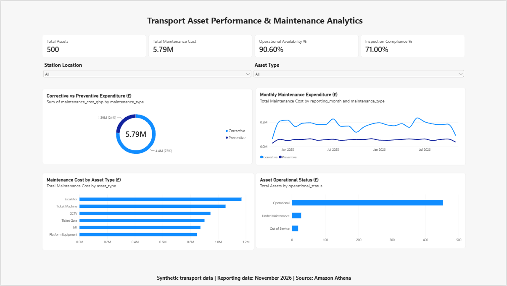
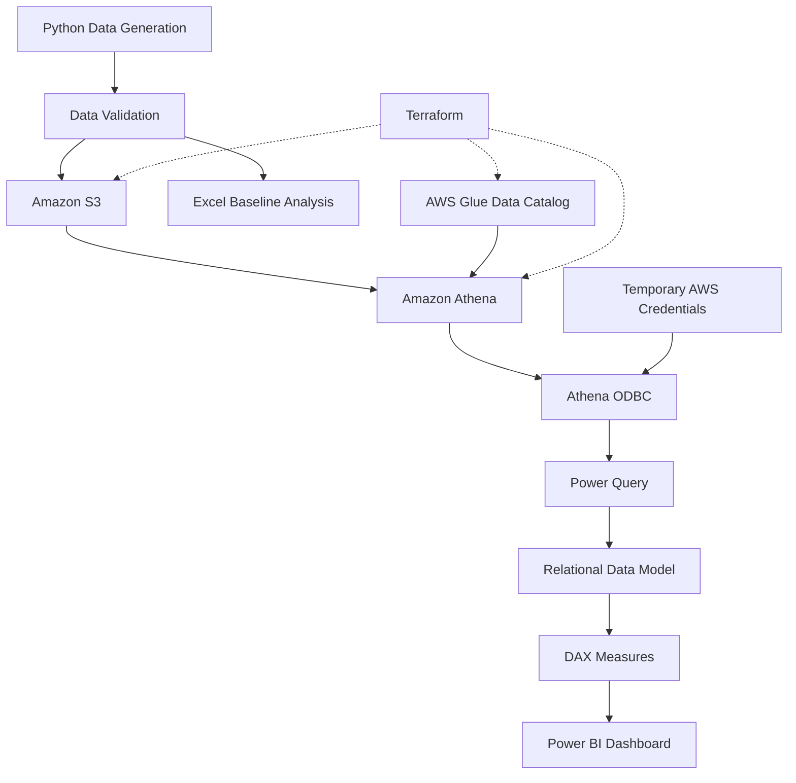
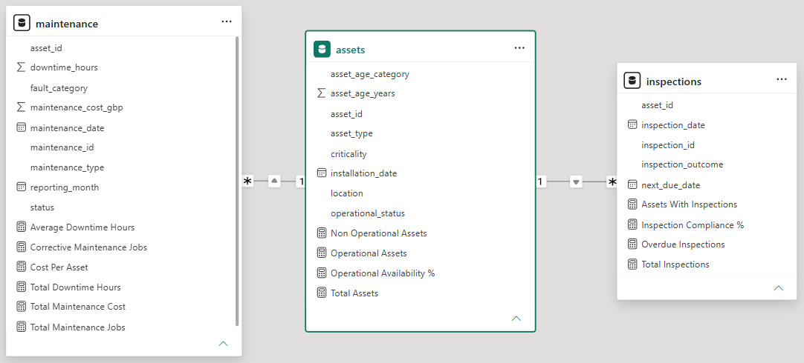
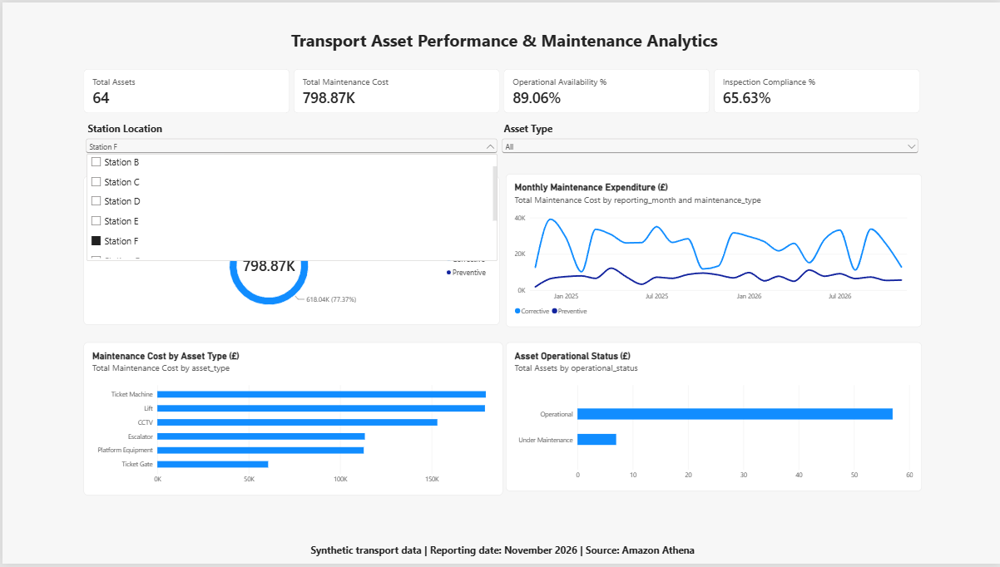
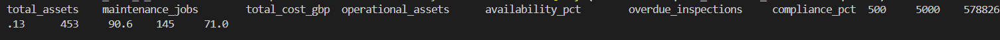

# Transport Asset Performance & Maintenance Analytics

**Developed by:** [JennyOma](https://github.com/JennyOma)

**Project type:** Independent professional portfolio project

**Year:** 2026

**Focus:** Cloud Engineering | Data Analytics | Business Intelligence

An end-to-end cloud analytics and business intelligence platform designed to support transport asset performance monitoring, maintenance planning, expenditure analysis and inspection schedule compliance.

The project integrates AWS, Terraform, Python, SQL, Excel and Microsoft Power BI using 7,500 synthetic records.

## Power BI Dashboard



The interactive dashboard enables management to monitor asset performance and explore maintenance expenditure by station and equipment category.

## Business Objectives

- Analyse corrective and preventive maintenance expenditure.
- Identify equipment categories associated with significant maintenance costs and downtime.
- Monitor operational asset availability.
- Assess overdue inspections and inspection schedule compliance.
- Compare maintenance performance across fictional stations.
- Support evidence-based asset management decisions.

## Technology Stack

| Technology | Application |
|---|---|
| Python | Synthetic data generation and validation |
| Microsoft Excel | PivotTable analysis and baseline validation |
| Terraform | Infrastructure as Code |
| Amazon S3 | Secure data lake storage |
| AWS Glue | Data Catalog and schema management |
| Amazon Athena | Serverless SQL analytics |
| AWS CLI | Cloud operations and query execution |
| PowerShell | Query automation |
| Athena ODBC | AWS-to-Power BI connectivity |
| Power Query M | Data transformation |
| DAX | Dynamic KPI calculations |
| Power BI | Interactive business intelligence |

## Solution Architecture



## Dataset Overview

| Dataset | Records |
|---|---:|
| Assets | 500 |
| Maintenance | 5,000 |
| Inspections | 2,000 |
| **Total** | **7,500** |

The datasets cover six equipment categories across ten fictional transport stations.

All data is synthetic and contains no confidential transport organisation information.

## Relational Data Model



The asset dimension connects to the maintenance and inspection fact tables using one-to-many relationships through `asset_id`.

## Validated Business KPIs

Reporting date: 18 November 2026.

| KPI | Result |
|---|---:|
| Total assets | 500 |
| Maintenance activities | 5,000 |
| Inspection records | 2,000 |
| Total maintenance expenditure | £5,788,267.13 |
| Recorded downtime | 53,412.15 hours |
| Operational assets | 453 |
| Non-operational assets | 47 |
| Operational availability | 90.60% |
| Assets with overdue inspections | 145 |
| Inspection schedule compliance | 71.00% |

## Key Business Findings

- Corrective maintenance represents approximately 34% of maintenance activities but accounts for 76% of expenditure and 80% of recorded downtime.
- Average corrective maintenance downtime is 24.93 hours, compared with 3.22 hours for preventive maintenance.
- Escalators generate the highest total maintenance expenditure.
- Lifts have the highest average downtime per maintenance activity.
- Station F has the highest maintenance expenditure per asset.
- 145 assets have overdue inspections, highlighting the importance of inspection backlog prioritisation.

These findings reflect deliberately generated synthetic data patterns and do not establish real-world causal relationships.

## SQL Analytics

Seven SQL scripts demonstrate the following analytical capabilities:

| Script | Purpose |
|---|---|
| 01_maintenance_summary.sql | Corrective and preventive maintenance comparison |
| 02_asset_performance.sql | Asset-level relational analysis |
| 03_location_performance.sql | Station expenditure and cost per asset |
| 04_monthly_trends.sql | Monthly time-series analysis |
| 05_asset_availability.sql | Operational availability |
| 06_inspection_compliance.sql | Latest inspection and overdue analysis |
| 07_dashboard_validation.sql | Independent KPI validation |

SQL techniques include aggregations, joins, conditional aggregation, common table expressions and window functions.

## Power Query and DAX

Power Query transformations include:

- Asset age calculation.
- Asset age categorisation.
- Monthly reporting date calculation.
- Data type configuration.

Fourteen DAX measures support dynamic asset, maintenance and inspection KPIs.

## Interactive Reporting



Station and asset category slicers enable users to explore specific areas of the asset portfolio.

Power BI Import mode allows interactive reporting using the imported dataset without submitting new Athena queries for every dashboard interaction.

## Security and Cost Optimisation

- Private Amazon S3 bucket.
- S3 Block Public Access.
- SSE-S3 encryption.
- Bucket Owner Enforced object ownership.
- Encrypted Athena query results.
- Dedicated Athena workgroup.
- 10 MiB per-query data scan limit.
- Temporary AWS authentication through an IAM profile.
- No permanent access keys created for Power BI.
- Terraform-managed infrastructure.
- No dedicated database servers or Glue crawler runs.

The query scan limit is not an overall spending cap.

## Testing and Validation

- 13 Python data quality checks passed.
- Source record counts verified using Athena.
- Excel PivotTable results compared with SQL calculations.
- Power BI headline KPIs independently validated against Athena.
- Interactive dashboard filtering tested.



## Project Structure

```text
transport-asset-maintenance-analytics/
├── .github/workflows/
├── dashboard/
├── data/
│   ├── raw/
│   └── processed/
├── dax/
├── docs/
├── screenshots/
├── scripts/
├── sql/
├── terraform/
├── tests/
├── .gitignore
└── README.md
```

## Additional Documentation

- [Solution Architecture](docs/architecture.md)
- [Business Findings and Recommendations](docs/business_findings.md)
- [DAX Measures](dax/README.md)

## Limitations

- All data is fictional.
- Operational availability represents a snapshot rather than historical uptime.
- Inspection schedule compliance does not establish regulatory compliance or equipment safety.
- The first and last reporting months contain incomplete monthly data.
- Source refresh requires deployed AWS resources and valid authentication.

## Future Enhancements

- Predictive maintenance and statistical forecasting.
- Historical availability and reliability modelling.
- Automated data ingestion and transformation.
- Parquet storage and partitioning.
- Advanced anomaly detection.
- Automated inspection backlog notifications.

## Project Purpose

This independent portfolio project demonstrates practical cloud engineering, data engineering, SQL analytics, business intelligence and asset management decision-support capabilities.

## Deployment Status

The AWS infrastructure was successfully deployed, tested
and subsequently destroyed to minimise ongoing cloud costs.

All Power BI reporting data and project evidence have been
retained locally.

Terraform configuration includes an improved Athena workgroup
cleanup setting based on deployment experience.

## Copyright and Usage

© 2026 JennyOma. All rights reserved where applicable.

This repository is published for portfolio demonstration,
educational reference and professional evaluation.

Unauthorised reproduction, redistribution or commercial
use of protected project materials is not permitted,
except where allowed by law or GitHub's Terms of Service.