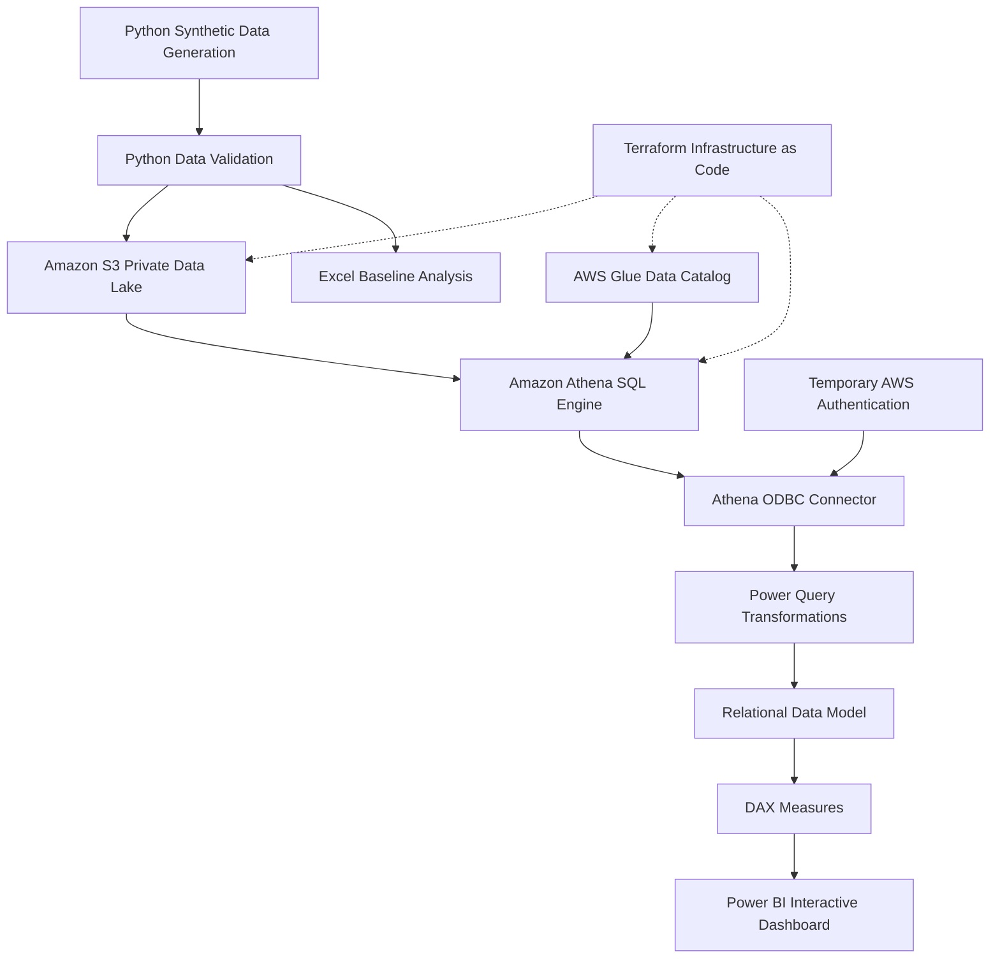

# Solution Architecture

## 1. Architecture Overview

The Transport Asset Performance and Maintenance Analytics platform uses a serverless AWS data lake architecture integrated with Microsoft Power BI.

The solution separates data storage, metadata management, SQL analytics and business intelligence.

## 2. Technology Stack

| Technology | Responsibility |
|---|---|
| Python | Synthetic data generation and validation |
| Excel | Independent baseline analytics |
| Terraform | Infrastructure as Code |
| Amazon S3 | Private data lake storage |
| AWS Glue Data Catalog | Schema and metadata management |
| Amazon Athena | Serverless SQL analytics |
| AWS CLI and PowerShell | Query execution and automation |
| Athena ODBC | Secure AWS-to-Power BI connectivity |
| Power Query M | Data transformation |
| DAX | Dynamic business metrics |
| Power BI | Interactive management reporting |

## 3. Data Architecture

The platform contains three relational datasets:

- Assets: 500 records
- Maintenance: 5,000 records
- Inspections: 2,000 records

The asset_id field provides the relationship between the asset dimension and the maintenance and inspection fact tables.

Python validation checks data quality and referential integrity before uploading datasets to Amazon S3.

## 4. Security Architecture

- S3 Block Public Access
- SSE-S3 encryption at rest
- Bucket Owner Enforced object ownership
- Encrypted Athena query results
- Dedicated Athena workgroup
- Temporary AWS authentication
- ODBC authentication using a dedicated local AWS profile
- No permanent access keys created for Power BI
- Terraform state and credentials excluded from version control

## 5. Cost Optimisation

The serverless architecture avoids dedicated database servers and continuously running compute instances.

Cost controls include:

- Athena per-query scan limit of 10 MiB
- Small synthetic datasets
- Terraform-defined Glue catalogue tables instead of crawler runs
- Power BI Import mode instead of DirectQuery
- Infrastructure cleanup following project validation

The query scan limit is not an overall spending cap.

## 6. Architectural Decision — S3 Instead of RDS

Amazon S3 was selected because the primary workload is historical data analytics rather than transactional processing.

Athena supports SQL joins and aggregations across datasets stored in S3, eliminating the need for a dedicated relational database server for this workload.

Unlike an operational relational database, S3 does not enforce primary and foreign key constraints. Referential integrity is therefore validated programmatically.

## 7. Business Intelligence Architecture

Power BI connects to Athena through the 64-bit ODBC driver using temporary AWS credentials.

Power Query prepares the imported data. A relational semantic model supports fourteen DAX measures and interactive dashboard filtering.

Import mode allows users to interact with the saved report without executing an Athena query for every interaction.

Refreshing the source data requires the AWS infrastructure and valid authentication.
## 8. Architecture Diagram

